<picture>
  <source media="(max-width: 600px) and (prefers-color-scheme: dark)" srcset="assets/header-dark-m.svg">
  <source media="(max-width: 600px)" srcset="assets/header-light-m.svg">
  <source media="(prefers-color-scheme: dark)" srcset="assets/header-dark.svg">
  
</picture>

<picture>
  <source media="(max-width: 600px) and (prefers-color-scheme: dark)" srcset="assets/about-dark-m.svg">
  <source media="(max-width: 600px)" srcset="assets/about-light-m.svg">
  <source media="(prefers-color-scheme: dark)" srcset="assets/about-dark.svg">
  
</picture>

<picture>
  <source media="(max-width: 600px) and (prefers-color-scheme: dark)" srcset="assets/projects-dark-m.svg">
  <source media="(max-width: 600px)" srcset="assets/projects-light-m.svg">
  <source media="(prefers-color-scheme: dark)" srcset="assets/projects-dark.svg">
  
</picture>

<picture>
  <source media="(max-width: 600px) and (prefers-color-scheme: dark)" srcset="assets/kodbox-dark-m.svg">
  <source media="(max-width: 600px)" srcset="assets/kodbox-light-m.svg">
  <source media="(prefers-color-scheme: dark)" srcset="assets/kodbox-dark.svg">
  
</picture>

<picture>
  <source media="(max-width: 600px) and (prefers-color-scheme: dark)" srcset="assets/campus-dark-m.svg">
  <source media="(max-width: 600px)" srcset="assets/campus-light-m.svg">
  <source media="(prefers-color-scheme: dark)" srcset="assets/campus-dark.svg">
  
</picture>

<picture>
  <source media="(max-width: 600px) and (prefers-color-scheme: dark)" srcset="assets/sunum-dark-m.svg">
  <source media="(max-width: 600px)" srcset="assets/sunum-light-m.svg">
  <source media="(prefers-color-scheme: dark)" srcset="assets/sunum-dark.svg">
  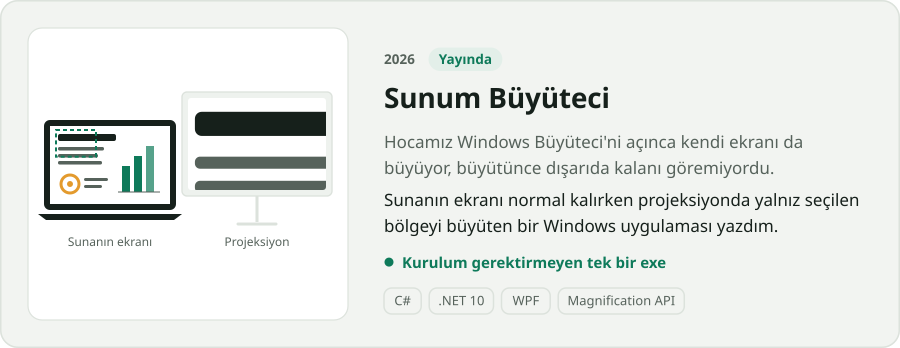
</picture>

<picture>
  <source media="(max-width: 600px) and (prefers-color-scheme: dark)" srcset="assets/tapo-dark-m.svg">
  <source media="(max-width: 600px)" srcset="assets/tapo-light-m.svg">
  <source media="(prefers-color-scheme: dark)" srcset="assets/tapo-dark.svg">
  
</picture>

<picture>
  <source media="(max-width: 600px) and (prefers-color-scheme: dark)" srcset="assets/xiaozhi-dark-m.svg">
  <source media="(max-width: 600px)" srcset="assets/xiaozhi-light-m.svg">
  <source media="(prefers-color-scheme: dark)" srcset="assets/xiaozhi-dark.svg">
  
</picture>

<picture>
  <source media="(max-width: 600px) and (prefers-color-scheme: dark)" srcset="assets/rfid-dark-m.svg">
  <source media="(max-width: 600px)" srcset="assets/rfid-light-m.svg">
  <source media="(prefers-color-scheme: dark)" srcset="assets/rfid-dark.svg">
  
</picture>

<picture>
  <source media="(max-width: 600px) and (prefers-color-scheme: dark)" srcset="assets/milyoner-dark-m.svg">
  <source media="(max-width: 600px)" srcset="assets/milyoner-light-m.svg">
  <source media="(prefers-color-scheme: dark)" srcset="assets/milyoner-dark.svg">
  
</picture>

<picture>
  <source media="(max-width: 600px) and (prefers-color-scheme: dark)" srcset="assets/stack-dark-m.svg">
  <source media="(max-width: 600px)" srcset="assets/stack-light-m.svg">
  <source media="(prefers-color-scheme: dark)" srcset="assets/stack-dark.svg">
  
</picture>

<picture>
  <source media="(max-width: 600px) and (prefers-color-scheme: dark)" srcset="assets/contact-dark-m.svg">
  <source media="(max-width: 600px)" srcset="assets/contact-light-m.svg">
  <source media="(prefers-color-scheme: dark)" srcset="assets/contact-dark.svg">
  
</picture>

